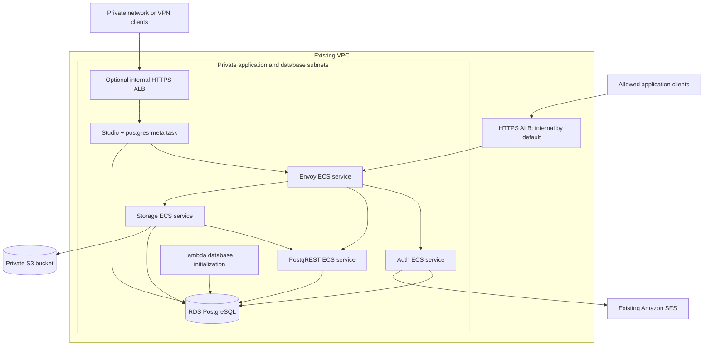

# Supabase on AWS

Supabase self-hosting for existing AWS infrastructure, built around **RDS PostgreSQL compatibility** and **independently scalable ECS services**. This community project adapts the [official Docker Compose setup](https://supabase.com/docs/guides/self-hosting/docker) into one CloudFormation stack with S3 storage, SES email, Secrets Manager, and CloudWatch logging.

Envoy, Auth, PostgREST, and Storage run as separate ECS services. Optional Studio and postgres-meta share one task. The stack creates RDS and the Storage bucket; shared networking, certificates, artifact storage, and SES come from the surrounding infrastructure.



## Quickstart

**Embed in existing infrastructure:** copy the source from a reviewed version into the consuming repository, preserving attribution:

```sh
mkdir -p infra/supabase
cp -R /path/to/supabase-aws/src/. infra/supabase/
cp /path/to/supabase-aws/{LICENSE,NOTICE} infra/supabase/
```

Populate `infra/supabase/parameters.json` from the example, then call the deployer after the shared foundation in the existing deployment script or pipeline:

```sh
./infra/supabase/deploy.sh --stack-name "$supabase_stack" --region "$region" \
  --parameters infra/supabase/parameters.json --artifacts-bucket "$artifacts_bucket"
```

See [integration details](docs/Deployment.md#embedding-source) for the shared inputs and outputs.

**Try a standalone demo:** the [wrapper](docs/Standalone-Wrapper.md) creates the foundation and deploys the same Supabase stack. From a checkout, supply an unused subdomain and its already delegated public Route 53 zone:

```sh
./wrapper/deploy.sh --domain supabase.example.com --hosted-zone-id Z0123456789EXAMPLE
```

[](https://console.aws.amazon.com/cloudshell/home?region=us-east-1)

The button opens CloudShell; obtain the source and run the command there. This creates **paid resources and a public HTTPS API** in `us-east-1`; it does not provision a production foundation. See [setup, costs, and cleanup](docs/Standalone-Wrapper.md).

## Requirements

For direct deployment. The wrapper has its own [account and domain prerequisites](docs/Standalone-Wrapper.md#before-starting).

- An AWS account with stack deployment permissions and an existing VPC, private subnets across two Availability Zones, and shared outbound connectivity.
- VPC encryption enforcement (default), or Service Connect TLS with an existing AWS Private CA. See [networking prerequisites](docs/Networking.md).
- An ACM certificate and private artifact bucket in the deployment region, plus an SES-verified sender and SMTP credentials in Secrets Manager. See [shared resources and permissions](docs/Deployment.md#shared-resources-and-permissions).
- AWS CLI v2, Bash, `jq`, OpenSSL, `zip`, and Python 3.13 with pip available as `python3`.

## Deploy

Copy [src/parameters.example.json](src/parameters.example.json) to the ignored `src/parameters.json` and set the resource IDs, hostnames, and secret ARN. Parameters contain references and settings, not secret values.

```sh
./src/deploy.sh \
  --stack-name supabase-demo --region us-east-1 --profile personal \
  --parameters src/parameters.json --artifacts-bucket YOUR_EXISTING_ARTIFACT_BUCKET
```

**This command deploys immediately.** It packages the artifacts, initializes RDS, and starts the services in one stack deployment. Rerun it for updates; unchanged stacks succeed without an infrastructure update.

- **Private access:** set `ApiClientSecurityGroupId` for the consuming application. Browsers and Auth email-link users also need private network access. Public access is opt-in through `ApiExposure=internet-facing` and `PublicSubnetIds`; see [access and DNS](docs/Networking.md#api-access-and-dns).
- **Application connection:** use the `ApiUrl` output and retrieve `SUPABASE_PUBLISHABLE_KEY` from the secret identified by `ApiSecretArn`. Keep secret, service-role, and signing keys on trusted servers.
- **Optional administration:** set `EnableStudio=true`, provide `StudioDomainName`, and restrict `StudioClientCidr`. Studio has privileged access and no built-in per-user login; see [administration setup](docs/Deployment.md#optional-administration).
- **Embedding in other infrastructure:** reuse the source and deployment script, or package the artifacts for an existing pipeline. See [execution roles, packaging, and database protection](docs/Deployment.md#execution-and-packaging).

## Defaults and boundaries

| Area | Default |
| --- | --- |
| Supabase release | `self-hosted/v0.8.3`; immutable images declared in `src/supabase.yaml` |
| Runtime | Linux x86-64 Fargate, private task IPs; ARM64 is opt-in through `EcsCpuArchitecture` ([compute choices](docs/Compute.md)) |
| API exposure | Internal HTTPS ALB, restricted to an existing client security group; public access is opt-in |
| Internal networking | VPC encryption enforcement with Cloud Map private DNS; Service Connect TLS is the alternative ([networking](docs/Networking.md)) |
| API services | Minimum two replicas each after scaling registration; CPU target tracking, maximum four each |
| Administration | Disabled; one combined task when enabled |
| Database | RDS PostgreSQL 17.6, `db.t4g.medium`, Multi-AZ, encrypted gp3; validate [workload sizing](docs/Compute.md#rds-workload-sizing) before production |
| Database backups | 14 days; deletion protection; snapshot on delete/replacement |
| Objects | Private encrypted S3 bucket with versioning; bucket and HTTPS-only policy retained on deletion; incomplete multipart uploads aborted after seven days |
| Authentication | Email confirmation required; public signups disabled; TOTP MFA enabled |
| API keys | Opaque publishable/secret keys, ES256 session signing, legacy compatibility keys |
| Database connections | Separate role passwords; TLS with RDS CA verification |
| Logs | Application/Lambda logs: 30 days; RDS/Insights retention unchanged unless `ServiceLogRetentionDays` is set; gateway omits request URLs/tokens |
| Task telemetry | Container Insights enabled; set `ContainerInsights=disabled` to omit paid task metrics while retaining service metrics, CPU scaling, and application logs |

- **Limited scope:** excludes Realtime, Edge Functions, Supavisor, analytics services, imgproxy, and an email-template server. Image transformations, the S3-compatible client API, GraphQL, and database webhooks are not provided.
- **Application access:** new tables need explicit grants and row-level security. The privileged service role bypasses RLS.
- **Capacity and cost:** ECS scaling does not scale RDS. Choose [compute and connection budgets](docs/Compute.md) for the workload and account for shared networking and encryption costs.
- **Data lifecycle:** API deletion is not permanent S3 erasure. Configure [retention](docs/Retention.md) to match recovery and deletion obligations.
- **Deployment model:** pinned official images; no custom container builds, stack-owned registry, or required CI/CD pipeline.

## Validate

The local suite combines script tests, template linting, and Docker/Moto integration without provisioning AWS resources. See [validation commands and coverage](CONTRIBUTION.md#validation).

Production use requires separate [manual AWS acceptance](docs/Deployment.md#manual-aws-acceptance). Local tests do not establish RDS-specific permissions, ECS networking, encryption enforcement, or SES delivery.

## Releases and operations

Upgrade Supabase as a coordinated release set using the [upstream changelog](https://github.com/supabase/supabase/blob/master/docker/CHANGELOG.md) and pinned sources in [NOTICE](NOTICE). Back up RDS and account for S3 changes first: container rollback does not reverse database migrations.

Use the [credential rotation runbook](docs/Credentials.md) for secret changes and service refresh, and the [removal guide](docs/Deployment.md#removal) for retained data and resources.

Contributions are welcome; see [CONTRIBUTION.md](CONTRIBUTION.md). Discuss self-hosting experiences in the [Supabase community thread](https://github.com/orgs/supabase/discussions/39820).

Inspired by [supabase-community/supabase-on-aws](https://github.com/supabase-community/supabase-on-aws). Gateway configuration is adapted from Supabase; see [NOTICE](NOTICE) and [LICENSE](LICENSE).
