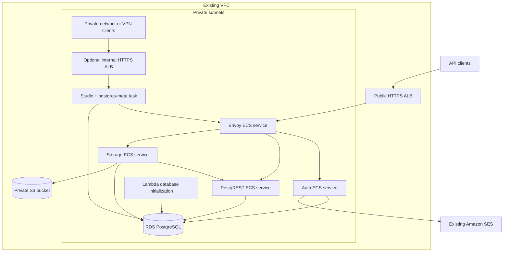

# Supabase on AWS

This community-maintained project adapts Supabase's [official Docker Compose self-hosting setup](https://supabase.com/docs/guides/self-hosting/docker) for enterprise AWS infrastructure, with two core goals: **Amazon RDS PostgreSQL compatibility** and **scalable deployment of Supabase containers on ECS**. It delivers the essential services in one CloudFormation stack, with independent scaling and operational controls, for embedding in existing company VPCs. Supporting AWS integrations, including S3 and SES, complement these core goals.

Bring an existing network, TLS certificate, and Amazon SES configuration.

The stack runs Envoy, Auth, PostgREST, and S3-backed Storage as separate ECS services. Optional Studio and postgres-meta share one task and an internal HTTPS load balancer. It does not deploy Realtime, Edge Functions, Supavisor, Logflare, Vector, an email-template server, or imgproxy. Image transformation and the optional S3-compatible client API are disabled; S3 remains the required object backend.



## Requirements

- An AWS account and permission to deploy CloudFormation, IAM, ECS, RDS, S3, Cloud Map, Lambda, CloudWatch, and load balancers.
- An existing VPC with DNS support/hostnames enabled, two public subnets, two private application subnets, and private database subnets spanning at least two Availability Zones. Application and database subnets may overlap.
- Outbound connectivity from application subnets for container pulls, AWS APIs, and SES SMTP port 587. The stack does not create NAT gateways or shared VPC endpoints. The bootstrap Lambda also needs HTTPS access to Secrets Manager and CloudFormation’s presigned S3 response URL. An S3 gateway endpoint is recommended; evaluate private endpoints for ECR, Secrets Manager, and Logs against your network/cost requirements.
- An existing ACM certificate in the deployment region covering the API hostname and, if enabled, the Studio hostname.
- An existing private S3 bucket in the deployment region for templates, Lambda ZIPs, and the RDS CA bundle. The deployer needs `s3:PutObject`/`s3:GetObject`; certificate readers receive access to only their CA object. Uploads use SSE-S3 encryption. Retain artifacts while referenced by current or rollback deployments; task replacements still download the CA bundle.
- An SES-verified sender identity with production sending access, plus a Secrets Manager JSON secret containing `username` and `password` for **SES SMTP credentials**. These are not ordinary AWS API credentials. SES identity verification, sandbox removal, quotas, and SMTP credential rotation remain account-level responsibilities.
- AWS CLI v2, Bash, `jq`, OpenSSL, `zip`, and Python 3.13 with pip. AWS credentials use the normal CLI configuration, including SSO profiles. Packaging downloads hash-verified Linux wheels into a temporary directory; Docker is only needed for local integration tests.

## Deploy

Copy `src/parameters.example.json` to the ignored `src/parameters.json` and supply your resource IDs, hostnames, and secret ARN. The file contains references and settings, not secret values.

```sh
./src/deploy.sh \
  --stack-name supabase-demo --region us-east-1 --profile personal \
  --parameters src/parameters.json --artifacts-bucket YOUR_EXISTING_ARTIFACT_BUCKET
```

Without `--apply`, this packages and uploads the Lambda ZIP, CA bundle, and template, then creates a reviewable CloudFormation change set without executing it. Both a first installation and an update use **one stack deployment**.

Run the same command with `--apply` to deploy. CloudFormation provisions RDS, invokes the bootstrap Lambda, and starts ECS services only after initialization succeeds. The Lambda connects to RDS with verified TLS, initializes database prerequisites, and populates service credentials. Updates rerun bootstrap when its packaged source changes, preserving existing signing keys; deletion never alters the database.

The Bash deployer uploads artifacts under content-addressed S3 keys and passes `ArtifactsBucket`, `BootstrapKey`, and `CertificateKey` to the template. Keep those parameters out of your parameter file. `./src/deploy.sh --package /tmp/bootstrap.zip` produces the Lambda package without AWS credentials; Python, SQL, dependencies, and the CA bundle remain separate files under `src/`. Other pipelines can package/upload these artifacts and deploy the same template.

The deployer installs a CloudFormation stack policy blocking database replacement/removal, preserving existing restrictions. It applies the policy before updates and immediately after successful first creation. Stack policies are an API setting, not a template resource; database deletion protection and snapshot policies are declared in the YAML. `--apply` creates and executes a fresh change set from the current files. Review changes before applying; an ECS rollback does not reverse database migrations.

Envoy uses its pinned official image. `src/deploy.sh` embeds `src/gateway-entrypoint.sh` into the template before upload; the `@include` marker is local packaging syntax, not a CloudFormation feature. Use `./src/deploy.sh --template > rendered.yaml` to produce the deployable template for review or another pipeline (with its S3 artifact parameters), without AWS credentials. Gateway configuration lives in `src/supabase.yaml`, and secrets are injected by ECS at task launch.

If `HostedZoneId` is supplied, the stack creates the API alias in that existing zone. Otherwise point `ApiDomainName` at the `ApiLoadBalancerDnsName` output yourself. DNS must match the supplied certificate. The API is HTTPS-only.

`ApiSecretArn` identifies the generated API credentials. Retrieve only `SUPABASE_PUBLISHABLE_KEY` for clients; keep `SUPABASE_SECRET_KEY`, legacy service-role keys, and signing keys on trusted servers. The stack never returns secret values through outputs.

## Optional administration

Set `EnableStudio=true`, provide `StudioDomainName`, and narrow `StudioClientCidr` to your private/VPN clients. Create the Studio DNS record pointing at `StudioLoadBalancerDnsName`; it must resolve for those clients. The certificate must cover this hostname.

Studio has privileged database access. Network access is its access-control boundary in this version: there is no public administration endpoint or built-in per-user Studio login. Only trusted administrators should have access to the allowed network. postgres-meta listens within the shared task and has no load balancer or public gateway route. Disable both components together with `EnableStudio=false`.

Studio snippets are ephemeral across task replacement. Store durable schema changes in your own version-controlled migrations rather than relying on Studio's local files.

## Defaults and boundaries

| Area | Default |
| --- | --- |
| Supabase release | `self-hosted/v0.8.3`; immutable images declared in `src/supabase.yaml` |
| Runtime | Linux x86-64 Fargate, private task IPs |
| Discovery | Cloud Map private DNS; Envoy refreshes service addresses |
| API services | Two replicas each; CPU target tracking, maximum four each |
| Administration | Disabled; one combined task when enabled |
| Database | RDS PostgreSQL 17.6, `db.t4g.medium`, Multi-AZ, encrypted gp3 |
| Database backups | 14 days; deletion protection; snapshot on delete/replacement |
| Objects | Private encrypted S3 bucket with versioning and retention on stack deletion |
| Authentication | Email confirmation required; public signups disabled; TOTP MFA enabled |
| API keys | Opaque publishable/secret keys, ES256 session signing, legacy compatibility keys |
| Database connections | Separate role passwords; TLS with RDS CA verification |
| Logs | ECS CloudWatch logging, 30-day retention; gateway omits request URLs/tokens |

Cloud Map avoids a proxy sidecar per application service; clients must handle task replacement and DNS refresh. PostgREST needs a readiness sidecar because its image does not include a shell/HTTP client. Certificate initialization uses the official AWS CLI image to copy the versioned CA bundle into a shared task volume; the probe uses the official Python image. All images are pinned by digest. There are no custom container builds or stack-owned ECR repositories.

This is a deliberately limited RDS integration, not parity with the managed Supabase platform or its custom Postgres distribution. It initializes the roles, schemas, JWT helper functions, and extensions required by the selected services. Auth and Storage apply their own release-specific schema migrations. It does not install unsupported Supabase Postgres extensions, GraphQL, database webhooks, or logical replication slots.

New public-schema tables are not automatically granted to API roles. Explicitly grant intended access and enable row-level security. The privileged service role bypasses RLS by design.

Set CPU/memory using valid Fargate combinations. Size service maximums and deployment surge together with RDS connection capacity; horizontal service scaling does not scale RDS. Initial per-replica pools are limited to five connections for Auth, PostgREST, and Storage, but migrations and background work can create additional connections. Retain database headroom. One replica is an explicit availability compromise.

The stack incurs ongoing charges for RDS, Fargate, ALBs, storage, logs, and optional administration. Existing NAT/endpoints and outbound data incur their own charges. Private VPC traffic between ALBs and services is HTTP; client ingress and database connections use TLS. Add end-to-end service TLS if your requirements demand it.

## Validate

Development checks additionally require ShellCheck and Docker for the disposable integration fixtures.

```sh
python3.13 -m venv .venv
.venv/bin/pip install --require-hashes -r tests/requirements.txt
shellcheck src/deploy.sh src/gateway-entrypoint.sh
./src/deploy.sh --template > /tmp/supabase.yaml
.venv/bin/cfn-lint /tmp/supabase.yaml
.venv/bin/python -m unittest discover -s tests -p 'test_*.py'
./src/deploy.sh --package /tmp/bootstrap.zip
.venv/bin/python tests/integration.py /tmp/bootstrap.zip
.venv/bin/pip-audit -r src/requirements.txt --disable-pip --no-deps
```

The integration test reads service images, environment settings, secrets mappings, and startup commands from the template, substituting local database and email fixtures. It loads the ZIP in the official Lambda runtime and covers verified database TLS, repeatable Lambda bootstrap with key preservation, certificate download, PostgREST readiness, Auth/Storage migrations, opaque-key translation, ES256 sessions and refresh, public JWKS safety, RLS, and excluded public routes. It does not prove RDS-specific role restrictions, ECS networking/IAM, or SES delivery.

Before production use, deploy a disposable AWS stack and verify: database bootstrap; all ECS services stable; actual signup/invitation and recovery emails through SES; token refresh and MFA; authenticated/anonymous RLS behavior; private S3 upload/download/delete and signed URLs; task replacement under traffic; Studio unreachable outside its allowed network; and snapshot restoration. Use `tests/acceptance.py --stack-name NAME --region REGION --profile PROFILE` for an S3 object round trip through the deployed Storage API.

## Releases and operations

Review the [Supabase self-hosting changelog](https://github.com/supabase/supabase/blob/master/docker/CHANGELOG.md) as a release set. Reconcile gateway configuration, environment variables, service migrations, and RDS compatibility before changing versions. `NOTICE` identifies the pinned upstream sources for comparison. Container tags are resolved to immutable digests. Review Python dependency updates with `uv pip compile --generate-hashes`, regenerate the source and test lock files, and rerun checks.

The October 2026 Storage release contains security fixes and one-way database migrations. Do not assume changing the image back restores compatibility. Back up RDS and account for S3 object changes before an upgrade. The bootstrap Lambda is retryable and preserves signing keys; it is not a database downgrade mechanism or a general credential-rotation tool.

Secrets injected into ECS containers are read at task launch. Rotate credentials through a coordinated database/secret update and service rollout; changing a secret alone does not update running tasks. Monitor RDS connections/free storage, ECS task failures/memory, API errors/latency, and SES delivery/bounces. Protect privileged secret reads with IAM.

To remove a deployment, first disable database deletion protection explicitly. RDS snapshots, S3 data, secrets, and logs are retained by policy; review and remove retained resources separately when they are no longer needed.

Contributions are welcome; see [CONTRIBUTION.md](CONTRIBUTION.md) for the workflow and contribution requirements.

Discuss Supabase self-hosting setups, experiences, and ideas in the community thread [Self-hosting: What's working (and what's not)?](https://github.com/orgs/supabase/discussions/39820) on Supabase's GitHub.

Inspired by [supabase-community/supabase-on-aws](https://github.com/supabase-community/supabase-on-aws). Gateway configuration is adapted from [Supabase](https://github.com/supabase/supabase), under Apache-2.0; see `NOTICE` and `LICENSE`.
